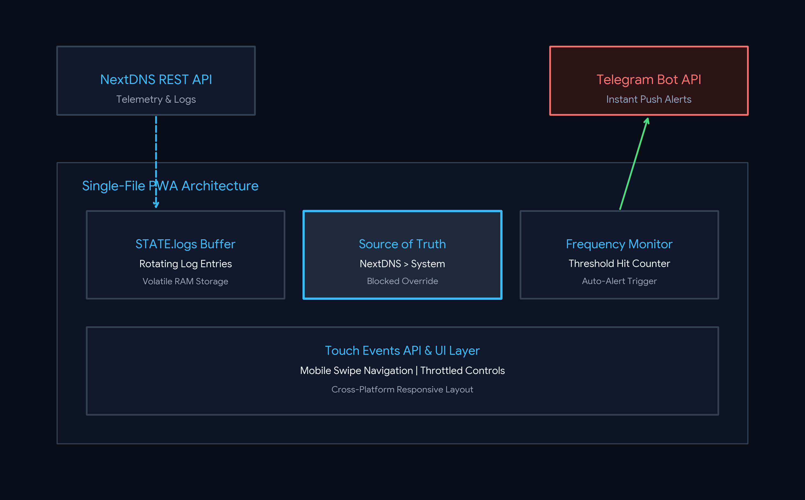

# NextDNS Live Viewer

> A lightning-fast, stateless, and privacy-first real-time telemetry viewer and analytics dashboard for NextDNS.

## Overview

**NextDNS Live Viewer** is a lightweight, single-file Progressive Web App (PWA) designed to provide instant, real-time insights and quick-action controls for your NextDNS traffic. Built with a pure RAM-first telemetry architecture, NextDNS remains the absolute **Single Source of Truth**, ensuring that historical logs remain true while allowing seamless runtime management.

🌐 **Live Demo:** [nextdns-dashboard-e3q.pages.dev](https://nextdns-dashboard-e3q.pages.dev/)

---

## Architecture

  

## Key Features

### 1. Interactive Status-Badge Toggles (Quick Deny & Quick Remove)
* **Allowed (Green):** Click directly on the status badge to instantly trigger a quick-deny action (`addQuickDeny`), blocking the domain and switching the badge to an **Amber (Blocked)** state.
* **Manually Blocked (Amber):** Click on the amber badge to trigger quick-remove (`removeQuickDeny`), instantly lifting the block and restoring the status to green.
* **System Protected & API Blocks:** Immutable NextDNS blocks (Red) and system-protected domains (Blue) remain securely locked to prevent accidental misconfigurations.

### 2. Frequency Monitor & Guardrail
* Tracks domain request frequencies across devices.
* Configurable request thresholds (`STATE.config.threshold`) with visual progress bars.
* Built-in `PROTECTED_DOMAINS` array to safeguard core infrastructure (Apple, Google, Microsoft, NTP, OCSP).

### 3. Telegram Notification API
* Automated instant alerts dispatched directly via Telegram Bot API when a monitored domain exceeds the request threshold during a session.

### 4. Robust UX & Navigation
* **Seamless Touch Swiping:** Mobile-optimized swipe navigation between tabs (`touch-action: pan-y`) while keeping form inputs and text selection fully functional.
* **Sticky Navigation Tabs:** Always accessible right below the header.
* **Responsive Layouts:** Adaptive tables and compact KPI grids designed for smartphones, tablets, and desktops.

---

## Screenshot

  

---

## License

MIT License — feel free to use, modify, and self-host!
