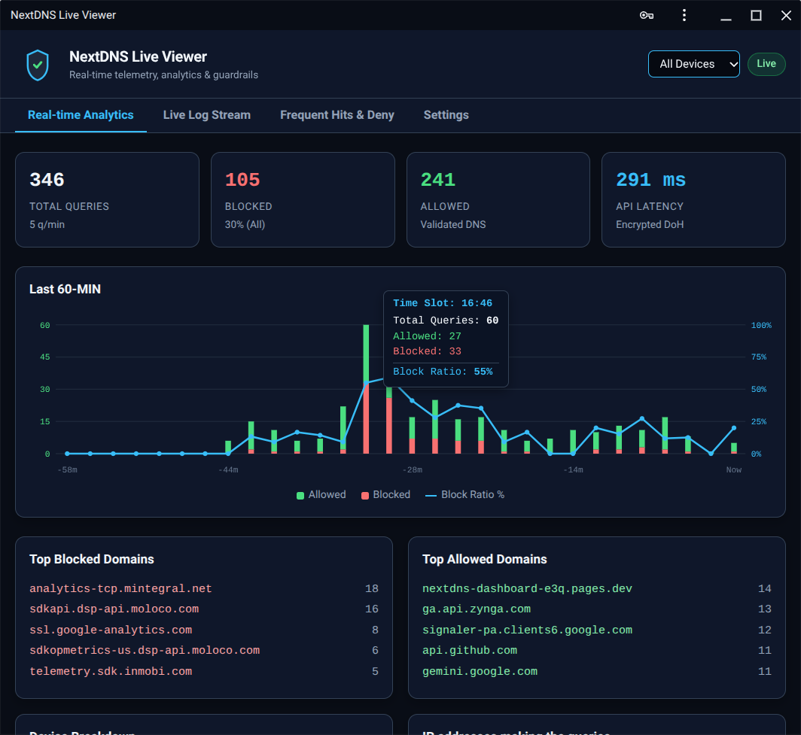

# NextDNS Live Viewer

> A lightning-fast, stateless, and privacy-first real-time telemetry viewer and analytics dashboard for NextDNS.

[](https://nextdns-dashboard-e3q.pages.dev/)
[]()

## Overview

**NextDNS Live Viewer** is a lightweight, single-file Progressive Web App (PWA) designed to provide instant, real-time insights and quick-action controls for your NextDNS traffic. Built with a pure RAM-first telemetry architecture, NextDNS remains the absolute **Single Source of Truth**, ensuring that historical logs remain true while allowing seamless runtime management.

🌐 **Live Demo:** [nextdns-dashboard-e3q.pages.dev](https://nextdns-dashboard-e3q.pages.dev/)

---

## Architecture

The diagram below illustrates the data flow, state management, and separation of concerns within the application:

```mermaid
graph TD
    A[NextDNS API / Live Simulator] -->|Batch / Stream| B(Central Handler: handleIncomingLog)
    
    subgraph RAM Buffers (Volatile State)
        B -->|Max 500 entries| C[STATE.logs <br> Live Stream Table]
        B -->|Rolling 60 Min| D[STATE.chartLogs <br> Canvas Analytics Chart]
        B -->|Infinite Session| E[STATE.sessionLogs <br> KPIs & Device Filters]
    end

    subgraph Guardrails & Notifications
        E --> F[Frequency Monitor & Guardrail]
        F -->|Threshold Exceeded| G[Local Toast Alert]
        F -->|Threshold Exceeded| H[Telegram Notification API]
    end

    subgraph User Actions
        I[Interactive Status Badge] -->|Click Allowed/Blocked| J[Quick Deny / Quick Remove]
        J -->|API POST / RAM Set| K[NextDNS Profile / Runtime State]
    end
```

---


---

## 🏗️ Architecture & Data Flow

The diagram below illustrates the single-file PWA architecture, including volatile RAM buffers, the dual-source status logic, and the Telegram alert dispatcher:

```mermaid
flowchart TD
    %% Styling
    classDef cloud fill:#0f172a,stroke:#38bdf8,stroke-width:1.5px,color:#f1f5f9;
    classDef client fill:#1e293b,stroke:#334155,stroke-width:1px,color:#f1f5f9;
    classDef engine fill:#060911,stroke:#38bdf8,stroke-width:1.5px,color:#f1f5f9;
    classDef alert fill:#2a1215,stroke:#f87171,stroke-width:1.5px,color:#f1f5f9;

    subgraph External_Cloud [External Services]
        NextAPI["🌐 NextDNS REST API<br/>(Telemetry & Denial Rules)"]:::cloud
        TelegramAPI["📢 Telegram Bot API<br/>(Instant Push Alerts)"]:::alert
    end

    subgraph Single_File_PWA [Single-File PWA Architecture - index.html]
        subgraph Data_Storage [State & Storage]
            LS["💾 LocalStorage<br/>(API Keys, Threshold, Proxy)"]:::client
            RAM["⚡ Volatile Buffer<br/>(STATE.logs - 1000 Rotating Entries)"]:::client
        end

        subgraph Core_Engine [Core Guardrail & Logic]
            Poller["🔄 API Poller / Stream<br/>(10s Interval)"]:::engine
            TruthEngine{"⚖️ Source of Truth Engine<br/>(NextDNS > System > Allowed)"}:::engine
            FreqMon["📊 Frequency Monitor<br/>(Threshold Hit Counter)"]:::engine
        end

        subgraph UI_Layer [User Interface & Touch Layer]
            TouchNav["📱 Touch Event Swipe API<br/>(Mobile Nav - Tables Included)"]:::client
            LiveStream["🔴 Live Log Stream"]:::client
            HitsReport["📋 Frequency Report Tab"]:::client
            SettingsTab["⚙️ Settings & Throttled Controls"]:::client
        end
    end

    %% Connections
    NextAPI -->|Fetch Telemetry| Poller
    Poller -->|Push Logs| RAM
    RAM --> TruthEngine
    LS -->|Load Config| Core_Engine

    TruthEngine -->|Render Status| LiveStream
    TruthEngine -->|Count Hits| FreqMon
    
    FreqMon -->|Render Table| HitsReport
    FreqMon -->|Threshold Exceeded| TelegramAPI

    SettingsTab -->|Save & Throttle| LS
    TouchNav -->|Switch Tab| UI_Layer


## Key Features

### 1. Interactive Status-Badge Toggles (Quick Deny & Quick Remove)
* **Allowed (Green):** Click directly on the status badge to instantly trigger a quick-deny action (`addQuickDeny`), blocking the domain and switching the badge to an **Amber (Blocked)** state.
* **Manually Blocked (Amber):** Click on the amber badge to trigger quick-remove (`removeQuickDeny`), instantly lifting the block and restoring the status to green.
* **System Protected & API Blocks:** Immutable NextDNS blocks (Red) and system-protected domains (Blue) remain securely locked to prevent accidental misconfigurations.

### 2. Frequency Monitor & Guardrail
* Tracks domain request frequencies across devices.
* Configurable request thresholds (`STATE.config.threshold`) with visual progress bars.
* Built-in `PROTECTED_DOMAINS` array to safeguard core infrastructure (Apple, Google, Microsoft, NTP, OCSP).

### 3. Telegram Notification API
* Automated instant alerts dispatched directly via Telegram Bot API when a monitored domain exceeds the request threshold during a session.

### 4. Robust UX & Navigation
* **Seamless Touch Swiping:** Mobile-optimized swipe navigation between tabs (`touch-action: pan-y`) while keeping form inputs and text selection fully functional.
* **Sticky Navigation Tabs:** Always accessible right below the header.
* **Responsive Layouts:** Adaptive tables and compact KPI grids designed for smartphones, tablets, and desktops.

---

## Screenshot

<p align="center">
  
</p>

---

## License

MIT License — feel free to use, modify, and self-host!
